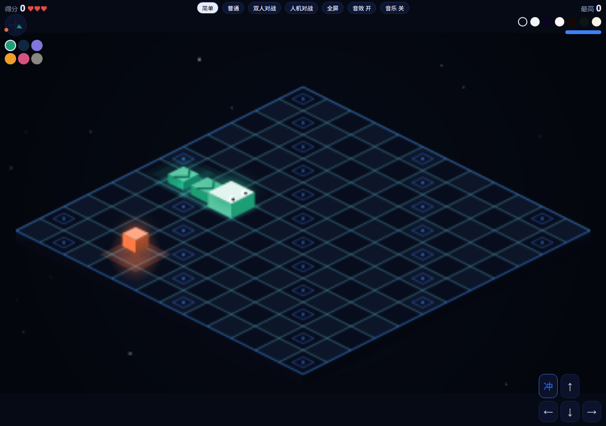
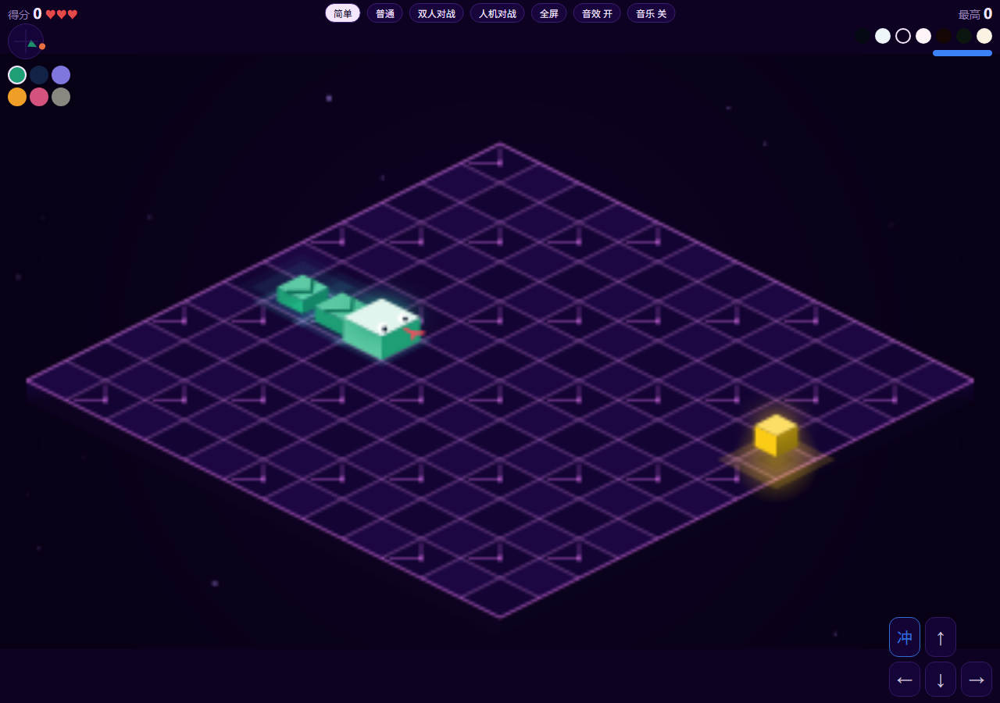
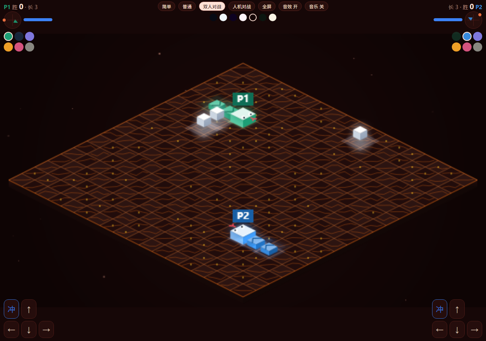

# 等距贪吃蛇 (Isometric Snake)

[](https://github.com/KKKK16689/isometric-snake/actions/workflows/build.yml)
[](LICENSE)

等距（2.5D）视角的贪吃蛇游戏。**单 HTML 文件、零依赖、纯 Canvas 渲染**，手机和电脑浏览器都能直接玩。

| 霓虹夜 | 赛博 | 熔岩（双人） |
|---|---|---|
|  |  |  |

## 在线试玩

**https://kkkk16689.github.io/isometric-snake/**

> 仓库 Settings → Pages → Source 选 `main` 分支 `/ (root)`，约 1 分钟后生效。

旧版 v3 存档（字节级原样，标签 `v3.0.0`）：**https://kkkk16689.github.io/isometric-snake/legacy/**

## 主题（7 套，一键切换）

霓虹夜 · 冰川 · 赛博 · 糖果 · 熔岩 · 森林 · 沙漠

每套主题自带配色、地板图案（脉冲网格 / 冰裂 / 电路 / 糖粒 / 余烬 / 苔纹 / 沙纹）与光影风格；选择会记在本机，下次打开仍是上次那套。

## 冲刺音效（6 套，可自选）

工具栏最右侧下拉框可切换：**喷气 / 蓄能 / 街机 / 脉冲 / 引擎 / 电弧**，全部由 WebAudio 实时合成，无音频文件。选择同样会本地记住。

## 游戏模式

| 模式 | 说明 |
|------|------|
| 简单 | 3 条命，速度慢，适合上手 |
| 普通 | 1 条命，速度更快，冲刺更耗电 |
| 双人对战 | 同屏对战，3 个食物，撞到对方或自己即输 |
| 人机对战 | 对抗 AI，AI 有 简单 / 普通 / 困难 三档难度 |

## 操作

| 平台 | 操作 |
|------|------|
| 电脑 · P1 | `WASD` 或方向键转向，`Shift` / `E` 按住冲刺 |
| 电脑 · P2 | 方向键转向，`Enter` / `/` 按住冲刺 |
| 手机 | 屏幕按钮或滑动转向，按住「冲」冲刺 |
| 通用 | `空格` / `P` 暂停，点击画面开始 / 继续 |

> 等距视角下**一键一方向**（4 个键各自控制一个格子方向）：`↑`/`W` = 右上、`→`/`D` = 右下、`↓`/`S` = 左下、`←`/`A` = 左上。
> 按到「与当前同向」或「正好反向」的键不动（不许原地掉头）；屏幕方向垫同理，滑动按屏幕象限对应这四个方向。

- 冲刺消耗能量，耗尽后锁定至恢复到 30 才能再次冲刺
- 罗盘：箭头是蛇的朝向，橙点指向最近的食物
- 工具栏：音效 / 音乐 / 震动 / 每日挑战 / 幽灵 / 复制成绩；对战模式还可切 AI 难度
- 最高分保存在本地（localStorage）
- 横屏或宽屏（≥760px）自动切换到沉浸式布局：画布吃满视口、HUD 悬浮叠加

## URL 参数

| 参数 | 作用 |
|------|------|
| `?theme=N` | 指定初始主题（0–6） |
| `?mode=easy/normal/pk/ai` | 指定初始模式 |
| `?daily=1` | 进入今日每日挑战 |
| `?seed=N` | 自定义种子的每日挑战 |
| `?autostart=1` | 自动开赛（截图 / 演示用） |
| `?fps=1` | 帧率诊断读数（fps / 帧时 / 画质档 / 漏帧率 / 背店尺寸与等效倍率，默认关闭）；末尾的 `stage3.1` 是构建标记——刷新后对着它就能确认浏览器拿到的是哪一版，不会被旧缓存骗到 |
| `?terrain=1`（或 `?terrain=<关卡id>`、`?level=<关卡id>`） | 开 3D 地形。**地形与模式正交**：普通 / 双人 / 人机都能开，工具栏的「3D」按钮效果相同；关掉就是 2.0 的原版玩法。当前关卡：`test-24`（24×24 灰模，全覆盖形状）、`harbor-32`（32×32 水渠＋跨水桥＋中央高台）、`ridges-40`（40×40 梯田＋湖上长桥＋墙阵） |
| `?q=0.4~1` | 固定画质倍率并关掉自适应降档（如 `?q=0.6`），用来 A/B 清晰度与流畅度 |
| `?interp=legacy` | 插值起点切回 2.0 的游戏时钟（起步会跳掉最多半格、更「冲」），用来对比按键响应手感 |
| `?span=0.5~1` | 每格的视觉到位只用「一格时间」的这个比例，其余时间停在新格上（如 `?span=0.7` 更「冲」），用来 A/B 手感 |

## 特性

- 等距 3D 方块渲染：蛇身渐缩、箭头缝线、眼睛和吐信动画
- 7 套主题 + 7 种地板图案，纯数据注册表驱动，加新主题不动核心逻辑
- 粒子特效系统（吃食、撞击、冲刺光轨、电弧），固定容量对象池，零 GC 压力
- 冲刺能量系统 + 能量条 UI；6 套可切换冲刺音效
- AI 对手：单次多源 BFS 距离场评估安全区域与食物距离，避免追食物钻进死胡同；残局空间不足时追自己尾格盘绕求生；冲刺竞速——严格比对手早到食物才烧能量
- 双人对战皮肤选择（双方不能同色）
- 全合成音效（WebAudio 振荡器 + 噪声 + 滤波器），无任何音频资源文件
- 连击计分：6s 内连续吃食，第 2 个起每个额外 +1（×2 封顶），HUD 显示连击数
- 金苹果：吃食后 12% 概率出现，6s 过期（最后 2s 闪烁告警），+3 分 +30 能量
- 每日挑战：同一种子全球同一局，结算可复制成绩分享对战（`?daily=1` / `?seed=N`）
- 幽灵回放：半透明重放本机破纪录局，和过去的自己同场竞速
- 本地统计：累计局数 / 食物 / 金苹果，结算页展示
- PWA：manifest + Service Worker 离线缓存，断网可玩，可安装到主屏幕
- 无障碍：读屏播报（aria-live）、尊重系统「减弱动态」、移动端震动反馈可开关

## 技术要点

- 零依赖，单文件成品（打包后约 105KB）
- **源码多文件 + 一键打包**：开发时按职责拆成 9 个模块，`node build.js` 内联成一个自包含 HTML
- 模块间通过事件总线单向通信，无强耦合；新增主题 / 图案 / 音色都是「往注册表加一条数据」
- 地板绘制一次后离屏缓存（offscreen canvas），每帧直接 `drawImage`
- 游戏逻辑与渲染分离；逻辑按固定 tick 步进，慢帧自动补 tick，游戏速度不依赖帧率
- 手感：转向在下一格移动时生效；渲染插值用**渲染时钟**起算（按下后立刻起步）并带**缓出曲线**（下一格到来前就基本到位）——线性插值要满一格才到位，观感上会「慢半拍」；`?interp=legacy` 可切回 2.0 时钟做对比
- 帧耗时滑动平均，设备变慢时自动关闭发光 / 电弧等重特效（lowFx 模式，带滞回恢复）
- 画布背店按「实测显示尺寸 × dprEff」重算（dprEff 受设备像素比、3 倍上限与像素预算 8M/4.5M 约束），静态地板顶点对齐设备像素，网格线宽固定 1 CSS px
- 自适应画质：按窗口统计漏帧率（帧间隔 > 25ms 即 60Hz 下漏一帧），持续掉帧就逐档降背店分辨率（下限 1 设备像素 = 1 CSS 像素），帧时富余且过了冷却再试探升回；只有在 dpr=1 的屏幕上、且漏帧率持续超过 35% 时，才允许再软到 0.75 倍 CSS（回升即复原）——`?fps=1` 的读数里 `(×N)` 就是当前等效倍率
- 渲染性能：光晕预渲染精灵、加法通道合批、逐帧零分配（对象池 / 原地压实 / 量化色表）、单一 rAF 循环
- 画家算法按 `x + y` 排序绘制，保证等距遮挡正确
- 经典 `<script>` 顺序加载（非 ES module），因此双击本地 HTML 文件也能直接运行，不受 CORS 限制
- 无头测试：`npm test` 共 61 用例——纯逻辑 23（vm 加载 core.js/ai.js：转向 / 方向键映射（一键一方向） / 连击 / 碰撞 / 填满判胜 / 种子确定性 / 200 局 AI 胜率 / 四模式随机 fuzz 不变量 / 长局 soak——四模式双 AI 自走，移动节奏不越界＋食物与身体唯一性全程成立 / 经典模式行为锁——定种子＋固定输入脚本跑 1200 tick 的状态摘要恒定，作为改地形规则时的回归护栏 / 3D 开关与模式正交——普通/双人/人机都能开、切模式不丢、关掉回原版棋盘 / 远征规则——桥下可通行且不吃上层食物、悬崖按高差阻挡、踩传送门下一步穿到对端 / 远征 soak——test-24、harbor-32、ridges-40 各 250+ 步逐帧校验层不变量：蛇身节必在可行走层、食物必在该格最高可走层、占位按层 / 远征 AI 批量对局——层图 AI 在三张图上跑批（`SOAK_GAMES` 可放大，500 局实测 0 撞地形 0 卡死））+ DOM 集成 23（零依赖 DOM/Canvas/WebAudio 桩按 index.html 顺序加载全部模块，确定性驱动帧循环：启动 / UI 按钮 / 触屏与滑动即时转向 / 主题×图案全遍历 / 四模式巡回 / 死亡结算 / URL 参数 / 减弱动态 / 旧存储键迁移 / Stage 0 背店分辨率 / 自适应画质降档与回升 / 帧率读数位置 / 诊断开关与缓出插值 / 插值时钟 / 手感契约——移动首帧画旧格不瞬移＋半程到位率＋全程单调不倒退 / 掉帧不补跑——600ms 大帧最多前进一格且不追赶式连跳 / 构建产物 index.html 内联脚本端到端直跑 / 经典模式视觉锁——两个种子各 90 帧的绘制轨迹摘要恒定 / 渲染成本护栏——主画布每帧绘制量预算＋静态地板缓存不得逐帧重画）+ 地形 10（terrain.js 层图：统计对齐参考校验器 / 选层与悬崖 / 邻接与占位键（含层号）/ 传送门成对 / 可达性 / 负例必须抛错 / 关卡开阔度守卫——三张图可走占比 ≥50%、无 1 格死胡同、出生点相距 ≥12 格）+ SW 离线策略 5（桩掉 self/caches/fetch 直驱事件：install 预缓存与 activate 换缓存 / 导航网络优先——刷新必得最新构建 / 资源 stale-while-revalidate 后台刷新 / 断网导航回退游戏壳 / legacy 存档页直通，跨域与 POST 不接管），CI 在 PR 上跑测试并做产物漂移检查

## 目录结构

```
index.html        # 打包成品（GitHub Pages 入口，双击即玩）
src/              # 源码：index.html 模板 + css/ + js/（core / themes / patterns / audio / particles / render / ai / input）
build.js          # 一键打包脚本（零依赖，node build.js）
test/             # 无头测试（node --test，零依赖）：core.test.mjs 纯逻辑 + integration.test.mjs DOM 集成 + sw.test.mjs 离线策略
tools/            # 图标生成器（零依赖 PNG 编码器，npm run icons）
sw.js             # Service Worker 离线缓存（仅 http(s) 注册）；导航网络优先、资源 stale-while-revalidate
manifest.webmanifest + icons/   # PWA 清单与图标
docs/superpowers/ # v2 / v3 设计文档（plans/ 实施计划 + specs/ 设计规格）
screenshots/      # 截图
```

## 本地运行

两种方式都可以：

1. 直接双击根目录 `index.html`（成品，零依赖）
2. 起个本地服务看源码版：`python -m http.server 8098`，访问 `http://localhost:8098/src/index.html`

> 音效需要浏览器音频策略解锁：先用鼠标点一下页面（或按任意键）再操作即可正常发声。

## 构建

改完 `src/` 后重新打包：

```bash
node build.js      # 或 npm run build
npm test           # 无头测试（node --test，纯逻辑 + DOM 集成）
npm run icons      # 重新生成 PWA 图标
```

## License

[MIT](LICENSE)
